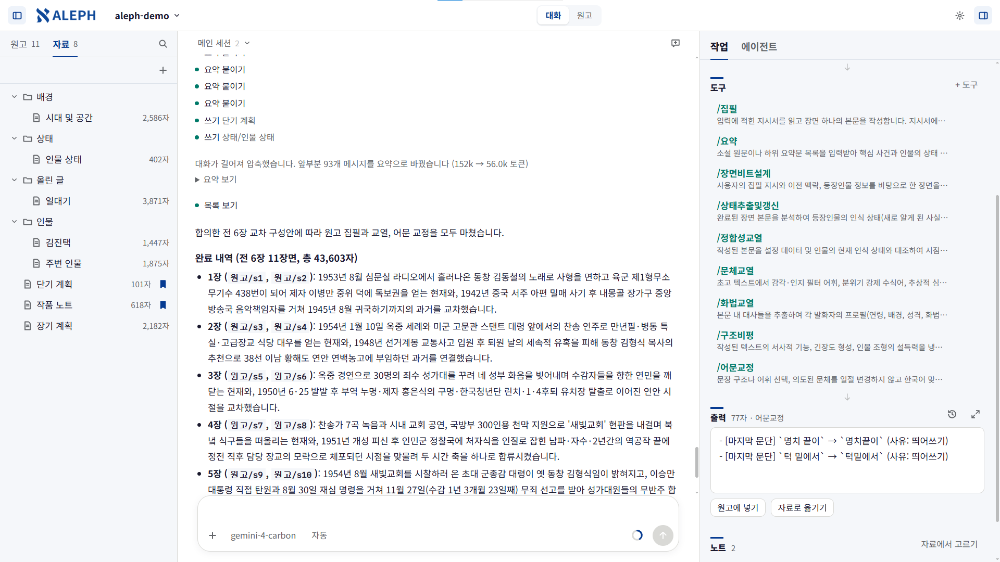
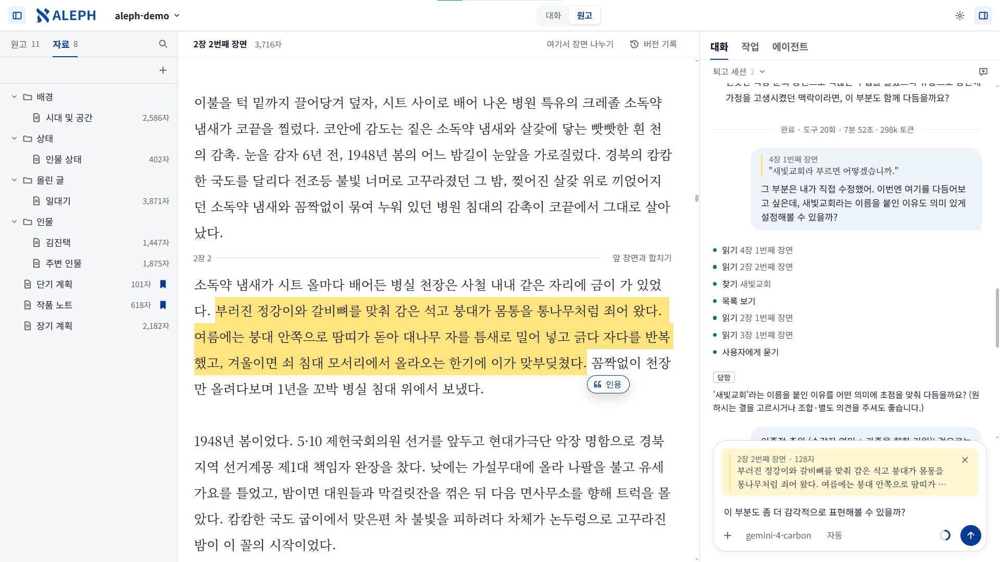

# ALEPH

***A**gentic **L**iterary **E**ngine for **P**rose **H**andling*

문학 이론을 에이전트의 작업 방식으로 구현하는 것을 목적으로 한 서사 창작 실험 장치입니다.
사전에 정의된 도구만을 사용하는 것이 아닌, 도구를 직접 정의하고 도구의 사용에 개입하는 과정 자체를 작업 루프에 포함시킨 것이 특징입니다.
에이전트가 무엇을 읽었고, 어떤 도구를 어떤 지시문으로 돌렸고, 어떤 과정을 거쳐 글이 나왔는지 전부 기록으로 남깁니다.

인터넷을 통해 배포되는 서비스가 아닌 로컬 환경에서 직접 서버를 구동해 실행하는 프로그램입니다. 모델은 포함되어 있지 않으며, 직접 연결하거나 호출하여 사용하여야 합니다.

## Tech Stack

- 엔진: Python 3.13, FastAPI, Pydantic AI
- 화면: TypeScript, React, Vite, Tailwind CSS, CodeMirror
- 모델 제공자: Google Gemini, Anthropic Claude, Google Cloud Vertex AI, OpenAI, xAI Grok, DeepSeek, OpenRouter, Ollama·LM Studio(로컬), OpenAI 형식 API 서버

※ 현재 버전에서 Gemini, Claude, Vertex AI 외의 제공자는 실제 호출로 확인하지 못했습니다.

## Screenshots

## Features

- **작업 공간**: 도구에 사용되는 입력과 출력, 에이전트와 사용자가 상호작용하는 데이터인 자료, 원고가 있습니다.
- **프리셋**: 에이전트 지침, 모델 설정, 도구를 사용자가 직접 만듭니다. 소스코드에는 프리셋이 따로 포함되어 있지 않습니다. 파일(`.alephpreset`)로 주고받을 수 있습니다.
- **도구**: 정해진 지시문으로 모델을 호출하는 기능입니다. 에이전트의 판단 하에 사용하거나, 사용자가 채팅창에서 `/도구이름`으로 직접 사용할 수 있습니다.
- **모드**: 에이전트의 권한과 수정 범위 등을 설정합니다. 기본적으로 수동, 자동, 자율, 계획 모드가 존재합니다.
- **원고**: 사용자와 에이전트가 동시에 상호작용할 수 있는 작업 공간이자 최종 산출 대상입니다. 에이전트의 가독성을 위해 각 장과 장면 단위로 분할해 요약과 함께 저장하는 것이 권장되며, 도구를 통해 이 작업을 자동화할 수 있습니다. 원고 편집 모드에서는 분할된 원고도 일반적인 텍스트 편집기처럼 상호작용할 수 있습니다.
- **수정 방지와 노트**: 수정 방지가 설정된 문서는 에이전트가 고칠 수 없습니다. 노트로 지정된 자료는 매 요청마다 에이전트의 컨텍스트에 자동으로 포함됩니다.
- **기록**: 문서의 변경과 이전 버전, 도구에 들어간 입력과 나온 출력, 실행마다 적용된 지침과 설정이 남습니다. 제작 기록으로 한 번에 내려받을 수 있습니다.
- **되돌리기**: 에이전트가 가장 최근 요청에서 바꾼 것을 한 번에 되돌립니다.
- **대화**: 작업 하나에 대화를 여러 개 둘 수 있습니다. 대화가 길어지면 앞부분을 요약으로 줄입니다.
- **같은 입력으로 비교하기**: 도구에 들어갔던 입력을 그대로 두고 모델이나 도구만 바꿔 다시 수행할 수 있습니다.
- **파일**: txt, md, docx, hwpx, pdf와 이미지를 올릴 수 있습니다. 원고는 txt, md, html, zip으로 내보냅니다. 작업 전체는 `.aleph` 파일로 내보내고 가져옵니다.
- **그 밖에**: 읽기 에이전트, 웹 검색과 웹 페이지 읽기(제공자가 지원할 때), 이미지 모델, 폰트 설정.

화면이 쓰는 HTTP API는 [backend/API.md](backend/API.md)에 있습니다.

## Installation

Windows에서 실행합니다.

1. [Releases](https://github.com/hwlee-dh/aleph/releases)에서 `ALEPH-v….zip`을 받아 원하는 폴더에 압축을 해제합니다.
2. `install.bat`을 더블클릭합니다. uv, Python, 패키지를 설치합니다. 첫 실행 때만 진행합니다.
3. `run.bat`을 더블클릭합니다. 터미널 창을 통해 서버가 실행되며, 브라우저에서 포트 접속 경로가 자동으로 열립니다. 터미널을 닫으면 종료됩니다.
4. 설정에서 AI를 연결하거나 호출용 API 키를 저장합니다.
5. 메인 화면에서 새 작업을 만들고, 채팅창에서 모델을 선택해 작업을 시작합니다.

외부 제공자의 모델을 쓰면 지침, 대화, 모델이 읽는 자료와 원고가 그 제공자의 서버로 전송될 수 있습니다.

키 없이 화면만 둘러보려면 `demo.bat`을 더블클릭합니다. 사전에 수행된 세션을 둘러볼 수 있습니다.

새 버전으로 바꿀 때는 새 배포 패키지를 다른 폴더에 풀고, 쓰던 폴더의 `data` 폴더와 `.env` 파일을 새 폴더로 옮긴 뒤 `install.bat`과 `run.bat`을 실행합니다.

별도의 인증이 없습니다. 서버를 `127.0.0.1` 밖으로 열면 안 됩니다.

## License

MIT 라이선스입니다. 전문은 [LICENSE](LICENSE)에 있습니다.
